<div align="center">

<a href="assets/banner.svg">
  
</a>

# 🚀 Awesome Interactive Presentation & Training Platform

<p align="center">
  <a href="https://github.com/ishandutta2007/Awesome-Awesome-Awesome"></a>
  <a href="https://discord.gg/jc4xtF58Ve"></a>
  <a href="https://github.com/ishandutta2007/Awesome-Interactive-Presentation-Training-Platform/stargazers"></a>
  <a href="https://github.com/ishandutta2007/Awesome-Interactive-Presentation-Training-Platform/network/members"></a>
  <a href="https://github.com/ishandutta2007/Awesome-Interactive-Presentation-Training-Platform/blob/main/LICENSE"></a>
  <a href="https://github.com/ishandutta2007"></a>
</p>

<p align="center">
  <strong>Curated directory of top-tier SaaS platforms, open-source virtual training rooms, audience response systems (ARS), live polling tools, gamified quiz engines, and interactive workshop frameworks.</strong>
</p>

<p align="center">
  <em>Powering real-time classroom participation, hybrid training workshops, corporate all-hands, and interactive developer presentations.</em>
</p>

</div>

---

## 📑 Table of Contents

- [🌐 Sector Overview & Market Dynamics](#-sector-overview--market-dynamics)
- [💼 SaaS & Hosted Training Platforms](#-saas--hosted-training-platforms)
- [💻 Open-Source GitHub Projects](#-open-source-github-projects)
- [🛠️ Architecture & Integration Guide](#️-architecture--integration-guide)
- [🤝 How to Contribute](#-how-to-contribute)
- [💖 Support](#-support)
- [📈 Star History](#-star-history)
- [📄 Disclaimer](#-disclaimer)

---

## 🌐 Sector Overview & Market Dynamics

The global **Interactive Presentation & Virtual Classroom software market** is estimated at **$15.2 billion in 2026** (growing at an estimated ~16.4% CAGR), accelerated by the permanent adoption of hybrid corporate learning, distributed all-hands meetings, and high-engagement digital higher education.

The sector exhibits **moderate fragmentation with specialized category concentration**:
- **Enterprise Video Collaboration Giants** (Cisco Webex via Slido, Microsoft Teams via Forms/Mesh, Zoom via Apps) capture baseline meeting polling.
- **Dedicated Interactive Presentation Leaders** (Kahoot!, Mentimeter, Zoho ShowTime, Poll Everywhere, AhaSlides) maintain strong customer stickiness through specialized gamification mechanisms, dynamic word clouds, enterprise SSO, LMS/LTI integrations, and dedicated presenter clicker hardware/plugins.
- **Open-Source & Privacy-First Self-Hosted Stacks** (BigBlueButton, Moodle, Reveal.js, Slidev, Excalidraw, ClassQuiz) command substantial market share across European public universities, defense organizations, and developer communities demanding full on-premise data sovereignty (GDPR, FERPA) and zero vendor lock-in.

---

## 💼 SaaS & Hosted Training Platforms

The following table provides an exhaustive comparison of industry-leading commercial interactive presentation and virtual training platforms, sorted by **Company Size (Revenue / Valuation)** in descending order:

| 🏷️ Platform | 🏢 Company Size (Revenue / Valuation) | 💵 Starting Tier Pricing | 🎁 Free Forever Tier Limit / Free Trial Limit | 🌟 Core Features & Highlights |
| :--- | :--- | :--- | :--- | :--- |
| **[Slido](https://slido.com)** *(Part of Cisco Systems)* | **$54B+ Annual Revenue** (Cisco parent market cap ~$230B) | **$12.50/month** ($150 billed annually, Engage plan) | **Free Forever**: Max 100 participants/event, up to 3 polls per event, and unlimited audience Q&A | Native PowerPoint, Google Slides, and Webex integration; live word clouds; participant upvoting; analytics exports. |
| **[Zoho ShowTime](https://zoho.com)** *(Part of Zoho Corp)* | **$1.4B+ Annual Revenue** (Bootstrapped, profitable global enterprise) | **$8.00/trainer/month** ($96 billed annually, Standard plan) | **15-Day Free Trial**: Full access for up to 25 attendees; no credit card required | Purpose-built virtual classroom with screen sharing, live polls, moderated Q&A, whiteboards, handouts, and trainee engagement metrics. |
| **[Kahoot!](https://kahoot.com)** *(Acquired by Goldman Sachs Asset Mgmt consortium)* | **$1.72B Valuation** (~$175M+ Annual ARR) | **$17.00/presenter/month** ($204 billed annually, Kahoot! 360 Presenter plan) | **Free Forever**: Up to 10 participants per game, basic multiple-choice quiz questions only | World-renowned gamified learning engine with music, countdown timers, team competition modes, and interactive training modules. |
| **[Mentimeter](https://mentimeter.com)** | **$50M+ ARR** ($300M+ valuation estimate) | **$11.99/presenter/month** ($143.88 billed annually, Basic plan) | **Free Forever**: Max 50 participants/month, unlimited presentations, max 2 question slides + 5 quiz slides per deck | Interactive presentation decks with dynamic live word clouds, rating scales, 20+ slide types, live Q&A, and mobile voting via QR code. |
| **[Poll Everywhere](https://polleverywhere.com)** | **$30M+ ARR** (Bootstrapped / self-sustaining enterprise ARR) | **$10.00/month** ($120 billed annually, Presenter plan) | **Free Forever**: Max 25 simultaneous audience responses per poll, unlimited questions | Seamless slide integration for PowerPoint, Apple Keynote, and Google Slides; clickable image heatmaps; upvoting; CSV reporting. |
| **[Wooclap](https://wooclap.com)** | **$12M+ ARR** (~€10M+ European SaaS) | **$9.99/month** (€8.99 billed annually, Basic Education / Pro plan) | **Free Forever**: Max 2 static events with up to 20 participants per event; all 20+ interactive question types included | 20+ interactive question templates (word cloud, sorting, matching, find on image), neuro-pedagogy research-backed design, and Canvas/Moodle LMS integration. |
| **[AhaSlides](https://ahaslides.com)** | **$8M+ ARR** (~4M+ active users globally) | **$7.95/month** ($95.40 billed annually, Essential plan) | **Free Forever**: Max 50 live participants per presentation, unlimited presentation slides and quizzes | Generous participant limits on free tier, spinner wheels, team quizzes, audio slides, and real-time open-ended brainstorming canvases. |
| **[Vevox](https://vevox.com)** | **$7M+ ARR** (Augmentum Fintech portfolio company) | **$11.40/month** ($136.80 billed annually, Individual Pro plan) | **Free Forever**: Max 100 participants per session for basic polling, max 3 polls per session, unlimited Q&A | Rated #1 for enterprise security; anonymous honest feedback; native Microsoft Teams & PowerPoint add-ins; live leaderboards. |
| **[Pigeonhole Live](https://pigeonholelive.com)** | **$5M+ ARR** (PigeonLab global enterprise clients) | **$12.00/month** ($144 billed annually, Pro monthly subscription) or $268/one-time event pass | **Free Forever**: Max 1 session per event with up to 20 attendees; includes live Q&A, multiple-choice polls, and surveys | Moderated Q&A workflows, participant anonymity, live agenda tracking, and dedicated enterprise live event management. |
| **[Conferences i/o](https://conferences.io)** | **$3M+ ARR** (Specialized CE/CPE compliance leader) | **$1,200/year** ($100/month starting annual license for single presenters / organizations) | **7-Day Free Trial**: Full feature test environment with simulated audience responses upon trainer request | Enterprise attendance verification and automated Continuing Professional Education (CPE/CE) credit tracking via live polling. |

---

## 💻 Open-Source GitHub Projects

Curated list of production-grade open-source virtual classroom suites, live audience response systems (ARS), interactive developer presentation engines, and collaborative whiteboards. Sorted by **GitHub Stars_Count** in descending order:

- **[Excalidraw](https://github.com/excalidraw/excalidraw)** <a href="https://github.com/excalidraw/excalidraw/stargazers"></a>  
  🎨 Virtual collaborative whiteboard with a hand-drawn feel. Heavily utilized in live technical workshops, software architecture trainings, and interactive design sessions with real-time end-to-end encrypted sharing.

- **[Reveal.js](https://github.com/hakimel/reveal.js)** <a href="https://github.com/hakimel/reveal.js/stargazers"></a>  
  📽️ The premier open-source HTML presentation framework. Features nested slides, Markdown support, speaker notes, PDF export, multiplex client synchronization, and plugins for real-time audience polling.

- **[TLDraw](https://github.com/tldraw/tldraw)** <a href="https://github.com/tldraw/tldraw/stargazers"></a>  
  🖌️ Infinite-canvas collaborative drawing SDK and application. Perfect for building custom interactive training rooms, synchronized whiteboard breakout spaces, and real-time visual collaboration workshops.

- **[Slidev](https://github.com/slidevjs/slidev)** <a href="https://github.com/slidevjs/slidev/stargazers"></a>  
  ⚡ Presentation tool for developers and technical trainers powered by Vite and Vue. Write slides in Markdown with embedded live interactive Vue components, Monaco code editors, LaTeX, and presenter views.

- **[Jitsi Meet](https://github.com/jitsi/jitsi-meet)** <a href="https://github.com/jitsi/jitsi-meet/stargazers"></a>  
  📹 Fully encrypted, 100% open-source WebRTC video conferencing application featuring built-in audience polls, breakout rooms, hand-raising, screen sharing, and streaming integrations.

- **[Formbricks](https://github.com/formbricks/formbricks)** <a href="https://github.com/formbricks/formbricks/stargazers"></a>  
  📋 Open-source survey suite and user experience platform. Ideal for gathering live post-presentation feedback, running comprehension checks, and administering pulse quizzes during workshops.

- **[Typebot](https://github.com/baptisteArno/typebot.io)** <a href="https://github.com/baptisteArno/typebot.io/stargazers"></a>  
  🤖 Open-source conversational form builder and interactive workflow engine. Widely used to build guided interactive training assessments, branching scenarios, and automated learner check-ins.

- **[BigBlueButton](https://github.com/bigbluebutton/bigbluebutton)** <a href="https://github.com/bigbluebutton/bigbluebutton/stargazers"></a>  
  🏫 Complete open-source virtual classroom platform designed specifically for teachers and trainers. Includes multi-user whiteboards, instant audience polling, breakout rooms, shared notes, and emojis/hand-raising.

- **[Open edX Platform](https://github.com/openedx/openedx-platform)** <a href="https://github.com/openedx/openedx-platform/stargazers"></a>  
  🎓 Scalable, enterprise-grade learning management and course authoring platform powering millions of learners with interactive grading modules, video checkpoints, and discussion boards.

- **[Moodle](https://github.com/moodle/moodle)** <a href="https://github.com/moodle/moodle/stargazers"></a>  
  🌍 The world's most customized open-source learning management system (LMS). Offers robust interactive workshop modules, real-time quiz banks, BigBlueButton integration, and H5P rich content.

- **[CodeSandbox Sandpack](https://github.com/codesandbox/sandpack)** <a href="https://github.com/codesandbox/sandpack/stargazers"></a>  
  📦 Component toolkit for creating live running code-editing environments within web presentations, interactive tutorials, and technical training slides.

- **[Quarto CLI](https://github.com/quarto-dev/quarto-cli)** <a href="https://github.com/quarto-dev/quarto-cli/stargazers"></a>  
  📊 Open-source scientific and technical publishing system based on Pandoc. Compiles Markdown and Jupyter Notebooks into interactive Reveal.js presentations with executable code and widgets.

- **[Judge0](https://github.com/judge0/judge0)** <a href="https://github.com/judge0/judge0/stargazers"></a>  
  ⚡ Robust, scalable, open-source online code execution system. Enables trainers to auto-grade live programming assignments and interactive coding quizzes across 60+ programming languages.

- **[RISE (Reveal.js - Jupyter/IPython Slideshow)](https://github.com/damianavila/RISE)** <a href="https://github.com/damianavila/RISE/stargazers"></a>  
  🪐 Instantly turns classic Jupyter Notebooks into live, executable Reveal.js presentations where instructors can run code cells and show live output directly on the slide.

- **[MiroTalk SFU](https://github.com/miroslavpejic85/mirotalksfu)** <a href="https://github.com/miroslavpejic85/mirotalksfu/stargazers"></a>  
  📡 Scalable WebRTC live video conferencing and virtual training portal powered by mediasoup SFU. Supports whiteboard collaboration, screen sharing, file transfers, and group chat.

- **[Kolibri](https://github.com/learningequality/kolibri)** <a href="https://github.com/learningequality/kolibri/stargazers"></a>  
  📶 Offline-first open-source educational platform and training tool designed for low-resource environments lacking internet connectivity. Provides structured interactive exercises and diagnostic assessments.

- **[Bolt Slides](https://github.com/stackblitz/bolt-slides)** <a href="https://github.com/stackblitz/bolt-slides/stargazers"></a>  
  ⚡ AI-powered interactive presentation engine from StackBlitz allowing creators to generate and present rich interactive web-based presentations with embedded live previews.

- **[Chamilo LMS](https://github.com/chamilo/chamilo-lms)** <a href="https://github.com/chamilo/chamilo-lms/stargazers"></a>  
  🏢 Open-source enterprise e-learning and corporate training management portal featuring skill management, interactive test engines, audio recording assessments, and live classroom integration.

- **[ClassQuiz](https://github.com/mawoka-myblock/ClassQuiz)** <a href="https://github.com/mawoka-myblock/ClassQuiz/stargazers"></a>  
  🎯 Modern open-source, privacy-friendly Kahoot! alternative. Allows presenters and trainers to host real-time multiplayer competitive quizzes where audience members participate via mobile devices.

- **[ILIAS LMS](https://github.com/ILIAS-eLearning/ILIAS)** <a href="https://github.com/ILIAS-eLearning/ILIAS/stargazers"></a>  
  🏛️ Robust, modular open-source LMS certified for enterprise training, university instruction, and military academies. Includes integrated live voting, assessment engines, and learning communities.

- **[Kahoot Alternative (Supabase)](https://github.com/supabase-community/kahoot-alternative)** <a href="https://github.com/supabase-community/kahoot-alternative/stargazers"></a>  
  📱 Open-source multiplayer quiz application built on Next.js, Tailwind CSS, and Supabase Realtime subscriptions for low-latency live audience score tracking.

- **[ARSnova / Particify Server](https://github.com/particify/arsnova-server)** <a href="https://github.com/particify/arsnova-server/stargazers"></a>  
  📊 Open-source backend for ARSnova/Particify, a privacy-first audience response system featuring live polls, anonymous Q&A, and lecture feedback designed for European academic institutions.

- **[frag.jetzt](https://github.com/thm-projects/frag.jetzt)** <a href="https://github.com/thm-projects/frag.jetzt/stargazers"></a>  
  💬 Open-source live Q&A moderation platform. Enables audiences to submit questions anonymously, upvote peers' queries, and interact with presenters during keynote presentations and university lectures.

---

## 🛠️ Architecture & Integration Guide

### 🧩 Recommended Open-Source Self-Hosted Stack

```text
┌────────────────────────────────────────────────────────┐
│                   Presenter & Trainees                 │
│              (Browsers, Tablets, Smartphones)          │
└───────────────────────────┬────────────────────────────┘
                            │
       ┌────────────────────┼────────────────────┐
       ▼                    ▼                    ▼
┌──────────────┐     ┌──────────────┐     ┌──────────────┐
│ Virtual Room │     │ Interactive  │     │ Audience Q&A │
│ & Audio/Video│     │ Presentation │     │ & Polling    │
│              │     │              │     │              │
│BigBlueButton │     │   Slidev /   │     │  Particify / │
│  or Jitsi    │     │  Reveal.js   │     │  ClassQuiz   │
└──────┬───────┘     └──────┬───────┘     └──────┬───────┘
       │                    │                    │
       └────────────────────┼────────────────────┘
                            ▼
               ┌────────────────────────┐
               │    Course Management   │
               │         & LMS          │
               │   Moodle / Open edX    │
               │ (LTI 1.3, SCORM, xAPI) │
               └────────────────────────┘
```

1. **Virtual Classroom & Breakouts**: Deploy **[BigBlueButton](https://github.com/bigbluebutton/bigbluebutton)** on a dedicated Ubuntu server with TURN/STUN configuration.
2. **Interactive Slides**: Author presentation materials using **[Slidev](https://github.com/slidevjs/slidev)** or **[Reveal.js](https://github.com/hakimel/reveal.js)** with live embedded Web components.
3. **Audience Response & Live Gamification**: Deploy **[ClassQuiz](https://github.com/mawoka-myblock/ClassQuiz)** or **[Particify](https://github.com/particify/arsnova-server)** for real-time mobile participation without account registration.
4. **Visual Brainstorming**: Embed **[Excalidraw](https://github.com/excalidraw/excalidraw)** or **[TLDraw](https://github.com/tldraw/tldraw)** within breakout rooms.
5. **LMS Integration**: Connect via standard **LTI 1.3** into **[Moodle](https://github.com/moodle/moodle)** or **[Open edX](https://github.com/openedx/openedx-platform)** to persist grades and participation analytics.

---

## 🤝 How to Contribute

Contributions are warmly welcomed! Help keep this directory accurate, comprehensive, and up to date:

1. 🍴 **Fork the repository** on GitHub.
2. 🌿 **Create a descriptive feature branch** (`git checkout -b add-platform-name`).
3. ✏️ **Add your project** to the respective table or open-source list in alphabetical or sorted order.
4. 📝 Ensure SaaS entries include verified **pricing, free tier limits, and company size metrics**.
5. 🔍 For open-source additions, include the official GitHub repository link with the required Stars_Count badge.
6. 🚀 **Submit a Pull Request** with a clear summary of why the tool is valuable for interactive presentations and training.

---

## 💖 Support

If you find this curated ecosystem helpful for choosing your presentation tools, designing training sessions, or building EdTech infrastructure:

- ⭐ **Star this repository** to help others discover it!
- 🍴 **Fork it** to bookmark your favorite tools and templates.
- 📢 **Share it** with colleagues, trainers, developers, and educators.
- ☕ **Support the maintainer**: Buy a coffee or become a sponsor at the **[Sponsor Dashboard](https://github.com/sponsors/ishandutta2007)**!

---

## 📈 Star History

[](https://www.star-history.com/#ishandutta2007/Awesome-Interactive-Presentation-Training-Platform&type=date&legend=top-left)

---

## 📄 Disclaimer

- This repository is a community-curated directory intended strictly for informational and educational purposes. Mentions do not constitute formal endorsements.
- Pricing plans, tier quotas, and corporate metrics are current as of late 2026 and are subject to change by respective platform vendors. Always consult official vendor pricing pages for live quotes.
- Live audience data collection must adhere to local privacy regulations including GDPR, FERPA, and CCPA when recording participant feedback or test results.

---

<div align="center">
  <sub>Maintained with ❤️ by <a href="https://github.com/ishandutta2007">Ishan Dutta</a> and the global open-source training community.</sub>
</div>
